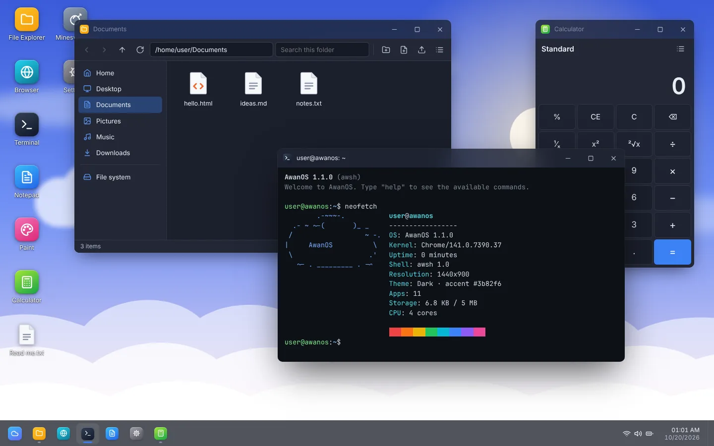

# AwanOS — OS Desktop Berbasis Web Statis

AwanOS adalah sistem operasi desktop yang berjalan sepenuhnya di browser. Seluruhnya dibuat dengan
HTML, CSS, dan JavaScript murni: **tanpa server, tanpa proses build, tanpa dependensi**. Cukup buka
`index.html`, atau unggah foldernya ke hosting statis mana pun.



## Fitur

- **Multibahasa**: antarmuka sistem tersedia dalam **bahasa Inggris** dan **Mandarin (简体中文)**, satu berkas
  per bahasa. Setiap aplikasi punya berkas bahasanya sendiri; saat ini semua aplikasi berbahasa Inggris.
  Ganti bahasa di **Settings → Language** (berlaku setelah mulai ulang).
- **Sesi lengkap**: layar boot, layar kunci dengan jam, login, kunci, keluar, mulai ulang, dan matikan.
- **Window manager**: jendela bisa digeser, diubah ukurannya dari 8 sisi, diminimalkan (dengan animasi ke
  bilah tugas), dimaksimalkan, dan di-*snap* (seret ke tepi kiri/kanan untuk membagi layar, ke atas untuk
  memaksimalkan). Klik dua kali judul jendela untuk maksimalkan/pulihkan.
- **Desktop**: ikon yang bisa diseret ke petak grid (posisinya diingat), seleksi kotak, rename langsung
  di tempat, menu klik kanan, dan seret-lepas ke folder.
- **Bilah tugas**: menu Mulai dengan pencarian aplikasi, berkas, dan web; aplikasi yang disematkan;
  indikator jendela aktif; pengaturan cepat (Wi-Fi, Bluetooth, mode pesawat, mode gelap, lampu malam,
  kecerahan, volume); kalender dan riwayat notifikasi.
- **Sistem berkas virtual** yang tersimpan di `localStorage`: buat, ganti nama, salin, potong, tempel,
  hapus, impor berkas asli dari komputer (seret-lepas atau tombol unggah), dan unduh kembali.
- **Personalisasi**: 8 wallpaper bawaan plus gambar sendiri, tema terang/gelap, warna aksen,
  efek transparansi, dan animasi.
- **Cadangan**: ekspor dan impor semua berkas serta pengaturan sebagai satu berkas JSON.
- **Responsif**: di layar ponsel jendela otomatis dimaksimalkan dan ikon bisa dibuka dengan sekali ketuk.

## Aplikasi bawaan

| Aplikasi | Keterangan |
| --- | --- |
| File Explorer | Tampilan ikon/daftar, riwayat navigasi, pencarian, salin/tempel, seret-lepas, impor/unduh |
| Notepad | Buka/simpan, cari & ganti, bungkus kata, zoom, sisipkan tanggal, peringatan perubahan belum disimpan |
| Terminal | Shell `awsh` dengan pipa (`\|`), pengalihan (`>`, `>>`), rantai (`&&`, `\|\|`, `;`), riwayat, dan Tab-completion |
| Browser | Penjelajahan web via iframe, beranda dengan tautan cepat, membuka berkas `.html` dari sistem berkas |
| Calculator | Kalkulator standar dengan riwayat, dukungan keyboard, dan format angka sesuai bahasa |
| Paint | Pensil, kuas, penghapus, garis, persegi, elips, isi warna, urungkan/ulangi, simpan PNG, jadikan wallpaper |
| Image Viewer | Zoom, sesuaikan jendela, gambar sebelumnya/berikutnya, edit di Paint |
| Minesweeper | Tiga tingkat kesulitan, klik pertama selalu aman, *chording*, rekor terbaik, mode bendera untuk layar sentuh |
| Task Manager | Daftar jendela yang berjalan, akhiri tugas, grafik FPS, info memori dan penyimpanan |
| Settings | Personalisasi, bahasa, akun, penyimpanan, cadangan, atur ulang, pintasan keyboard, info sistem |

## Menjalankan

**Langsung dari berkas** — klik dua kali `index.html`. AwanOS memakai skrip biasa (bukan ES module),
jadi tetap berjalan lewat `file://`.

**Dengan server lokal** (disarankan, agar perilakunya sama dengan saat di-hosting):

```bash
python3 -m http.server 8080
# lalu buka http://localhost:8080
```

**Hosting statis** — unggah seluruh isi repositori ke GitHub Pages, Netlify, Vercel, Cloudflare Pages,
atau hosting statis lain. Untuk GitHub Pages: *Settings → Pages → Deploy from a branch*, pilih branch dan
folder `/ (root)`. Berkas `.nojekyll` sudah disertakan.

Tambahkan `?skipboot` di akhir URL untuk langsung masuk ke desktop tanpa layar boot dan kunci
(berguna saat pengembangan).

## Pintasan keyboard

| Pintasan | Aksi |
| --- | --- |
| `Ctrl+Alt+S` | Buka menu Mulai |
| `Ctrl+Alt+T` | Buka Terminal |
| `Ctrl+Alt+E` | Buka File Explorer |
| `Ctrl+Alt+M` | Buka Task Manager |
| `Ctrl+Alt+D` | Tampilkan desktop |
| `Ctrl+Alt+W` | Tutup jendela aktif |
| `Ctrl+Alt+L` | Kunci layar |
| `F2` / `Delete` | Ganti nama / hapus berkas terpilih |
| `Ctrl+C` / `Ctrl+X` / `Ctrl+V` | Salin / potong / tempel berkas |

## Perintah terminal

`help`, `ls`, `cd`, `pwd`, `cat`, `echo`, `mkdir`, `touch`, `rm`, `rmdir`, `mv`, `cp`, `tree`, `find`,
`grep`, `head`, `tail`, `wc`, `sort`, `clear`, `date`, `cal`, `whoami`, `hostname`, `uname`, `uptime`,
`history`, `calc`, `open`, `edit`, `apps`, `theme`, `wallpaper`, `notify`, `df`, `du`, `neofetch`,
`cowsay`, `fortune`, `lock`, `reboot`, `shutdown`, `exit`.

Contoh:

```bash
mkdir -p proyek/web && cd proyek
echo "halo dunia" > web/catatan.txt
ls -l web | grep txt
calc 2*(3+4)^2
open ~/Documents/hello.html
```

## Bahasa

Teks antarmuka tidak ditulis langsung di kode, melainkan di berkas bahasa — **satu bahasa satu berkas**:

```
lang/en.js                 Teks sistem (bilah tugas, menu Mulai, dialog, layar kunci, …) — Inggris
lang/zh.js                 Teks sistem — Mandarin (简体中文)
apps/<id>/lang/en.js       Teks milik satu aplikasi — Inggris (saat ini semua aplikasi baru punya ini)
```

Saat boot, `OS.i18n.load()` hanya memuat berkas untuk bahasa yang dipilih (ditambah bahasa Inggris
sebagai cadangan bila ada teks yang belum diterjemahkan). Bahasa awal mengikuti bahasa browser, dan bisa
diganti di **Settings → Language**. Aplikasi yang belum punya terjemahan untuk bahasa sistem otomatis
tampil dalam bahasa Inggris.

Setiap berkas bahasa mendaftarkan kamusnya:

```js
// lang/zh.js (teks sistem)
OS.i18n.register('zh', { common: { ok: '确定', cancel: '取消' }, … });

// apps/notepad/lang/en.js (teks aplikasi: argumen ketiga = id aplikasi)
OS.i18n.register('en', { name: 'Notepad', menu: { save: 'Save' }, … }, 'notepad');
```

Di kode, teks diambil dengan kunci bertitik. `{nama}` diisi dari parameter, dan bentuk jamak memakai
akhiran `_one` / `_other` ketika parameter `count` diberikan:

```js
OS.t('start.lock');                              // teks sistem
const t = OS.i18n.forApp('notepad');             // teks aplikasi
t('menu.save');
t('status.chars', { count: 12 });                // status.chars_one / status.chars_other
new Intl.NumberFormat(t.locale).format(1234.5);  // format angka/tanggal sesuai bahasa
```

Elemen statis di `index.html` memakai atribut `data-i18n`, `data-i18n-title`, `data-i18n-aria-label`,
atau `data-i18n-placeholder`.

**Menambah bahasa sistem** — tambahkan entri di `LANGUAGES` pada `js/core/i18n.js`
(misalnya `{ code: 'id', name: 'Bahasa Indonesia', locale: 'id-ID' }`), lalu salin `lang/en.js` menjadi
`lang/id.js` dan terjemahkan nilainya.

**Menerjemahkan aplikasi** — salin `apps/<id>/lang/en.js` menjadi `apps/<id>/lang/<kode>.js`, terjemahkan,
lalu tambahkan kodenya ke `languages` di `OS.apps.register` aplikasi tersebut, misalnya
`languages: ['en', 'zh']`.

## Struktur proyek

```
index.html            Kerangka halaman dan urutan pemuatan skrip/gaya
lang/                 Teks sistem — satu berkas per bahasa (en.js, zh.js)
apps/                 Aplikasi — satu aplikasi satu folder
  explorer/           File Explorer
  notepad/            Notepad
  terminal/           Terminal
  browser/            Browser
  calculator/         Calculator
  paint/              Paint
  imageviewer/        Image Viewer
  minesweeper/        Minesweeper
  taskmanager/        Task Manager
  settings/           Settings
  about/              About AwanOS
    app.js            (setiap folder) logika aplikasi & pendaftarannya
    style.css         (setiap folder) gaya khusus aplikasi
    lang/en.js        (setiap folder) teks aplikasi — satu berkas per bahasa
css/system.css        Gaya shell: token tema, jendela, bilah tugas, menu, dialog, toolbar bersama
js/core/              Inti sistem
  utils.js            Pembuat DOM, event emitter, format angka/tanggal
  icons.js            Set ikon SVG inline
  settings.js         Penyimpanan, pengaturan, wallpaper, tema
  i18n.js             Daftar bahasa, pencarian teks, dan pemuatan berkas bahasa
  vfs.js              Sistem berkas virtual (localStorage)
  ui.js               Menu konteks, popup, dialog, pemilih berkas, notifikasi
  wm.js               Window manager
  apps.js             Registri aplikasi dan asosiasi berkas
  fileops.js          Operasi berkas bersama (salin, hapus, impor, unduh, …)
  migrate.js          Pembaruan sekali jalan untuk data dari versi lama
js/shell/             Desktop, bilah tugas, dan siklus sesi
js/main.js            Bootstrap dan pintasan global
assets/               Favicon, wallpaper SVG, tangkapan layar
```

## Membuat aplikasi sendiri

1. Buat folder baru `apps/<id>/` berisi `app.js`, `lang/en.js`, dan `style.css` bila perlu.
2. Muat skrip dan gayanya di `index.html`: `<link rel="stylesheet" href="apps/<id>/style.css">` di dalam
   `<head>`, dan `<script src="apps/<id>/app.js"></script>` di bagian *Applications*, sebelum skrip shell.
   Berkas bahasanya dimuat otomatis — tidak perlu tag tambahan.
3. Tulis teks aplikasinya di `apps/<id>/lang/en.js`. Kunci `name`, `description`, dan `keywords` dipakai
   untuk menu Mulai, bilah tugas, dan pencarian:

```js
OS.i18n.register('en', {
  name: 'Hello',
  description: 'Example app',
  keywords: ['hello', 'example'],
  message: 'Hello from a new app, {user}!',
}, 'halo');
```

4. Daftarkan aplikasinya di `app.js`:

```js
(function () {
  const { h } = OS.utils;
  const t = OS.i18n.forApp('halo');

  OS.apps.register({
    id: 'halo',
    languages: ['en'],              // bahasa yang punya berkas di apps/halo/lang/
    icon: 'smile',                  // nama glyph dari js/core/icons.js
    colors: ['#f59e0b', '#ef4444'], // gradasi ikon
    width: 360,
    height: 240,
    launch(win, args) {
      win.body.classList.add('halo');
      win.body.append(h('div', { class: 'halo-pesan' }, t('message', { user: OS.settings.get('username') })));
      win.on('close', () => console.log('window closed'));
    },
  });
})();
```

Awali selektor di `style.css` dengan kelas aplikasimu (misalnya `.halo-pesan { padding: 24px; }`)
agar gayanya tidak bocor ke aplikasi lain.

API yang tersedia antara lain `OS.wm.open(id, args)`, `OS.vfs.readFile/writeFile/readdir/…`,
`OS.ui.alert/confirm/prompt/pickFile`, `OS.notify({ title, body })`, `OS.settings.get/set`, dan
`OS.t` / `OS.i18n.forApp`.

## Catatan

- Data disimpan di `localStorage` browser yang sedang dipakai (umumnya sekitar 5 MB). Gambar besar yang
  diimpor otomatis diperkecil. Gunakan fitur cadangan di **Settings → System** untuk memindahkan data
  ke browser lain.
- Data dari versi lama (folder `Dokumen`, `Gambar`, `Musik`, `Unduhan` dan pintasan desktop berbahasa
  Indonesia) otomatis diubah ke nama baru (`Documents`, `Pictures`, `Music`, `Downloads`) saat pertama
  kali dibuka.
- Banyak situs (misalnya YouTube atau GitHub) melarang ditampilkan di dalam iframe, sehingga tidak bisa
  dibuka di aplikasi Browser. Gunakan tombol untuk membuka di tab baru bagi situs seperti itu.
- Membutuhkan browser modern (Chrome/Edge 111+, Firefox 113+, Safari 16.4+).
